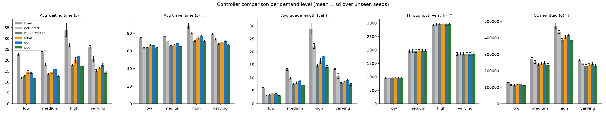
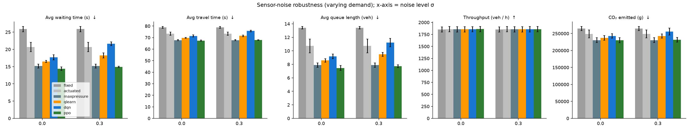
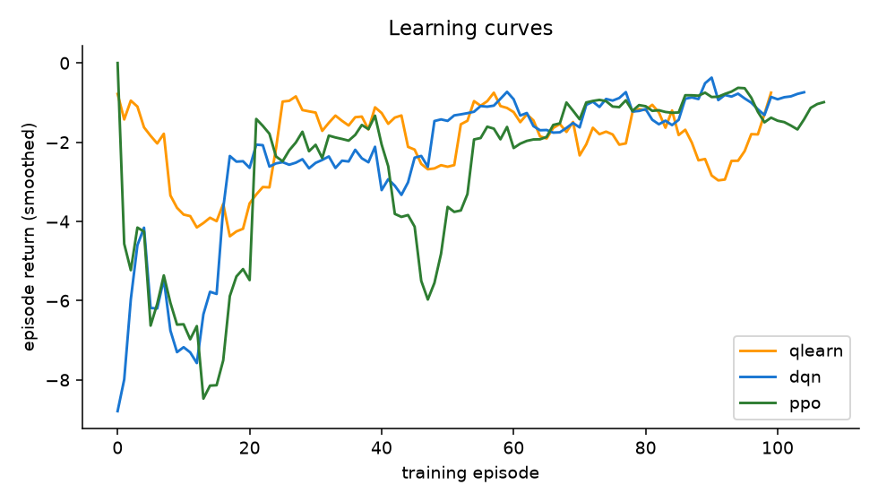

# RL-Based Adaptive Traffic Signal Control

Reinforcement learning for adaptive traffic signal control in the [SUMO](https://eclipse.dev/sumo/) microscopic traffic simulator.
A four-way intersection is modelled as a Markov Decision Process, and three RL agents (tabular **Q-learning**, **DQN** and **PPO**) are compared with three conventional controllers (**fixed-time**, **actuated** and **Max-Pressure**) under low, medium, high and time-varying demand.

**Honours Project, Group 6**

| | |
|---|---|
| **Authors** | Aleena James, Angela Maria Abhraham, Nikitha Nair, Nimisha S Shine |
| **Guide** | Ms. Neenu R |

**Keywords:** reinforcement learning, adaptive traffic signal control, SUMO, DQN, PPO, intelligent transportation systems

---

## Abstract

Urban traffic congestion increases travel time, fuel consumption and emissions. Most signalised intersections still use fixed-time or simple actuated controllers that cannot adapt well to changing, stochastic demand. This project investigates reinforcement learning (RL) for adaptive traffic signal control. A simulated four-way intersection is built in the SUMO microscopic traffic simulator and formulated as a Markov Decision Process, with states derived from lane-level queue and density measurements, actions that select signal phases, and rewards based on reduced vehicle waiting time. Tabular Q-learning, Deep Q-Networks (DQN) and Proximal Policy Optimization (PPO) agents are trained and compared against fixed-time, actuated and Max-Pressure baselines under low, medium, high and time-varying demand. Performance is measured by average waiting time, queue length, throughput, travel time and emissions, and robustness to sensor noise is tested.

---

## Key results

Average waiting time per vehicle in seconds (lower is better), mean of 3 unseen demand seeds, 3,600 s episodes:

| Demand | Fixed-time | Actuated | Max-Pressure | Q-learning | DQN | **PPO** |
|---|---|---|---|---|---|---|
| Low | 22.6 | 11.8 | 12.6 | 14.6 | 14.2 | **11.6** |
| Medium | 23.9 | 17.9 | 13.6 | 14.5 | 15.9 | **12.9** |
| High | 34.0 | 26.9 | 17.8 | 19.9 | 22.0 | **17.3** |
| Varying | 25.9 | 20.6 | 15.2 | 16.5 | 17.7 | **14.4** |

- PPO reduced average waiting time by **44–49%** compared with fixed-time control at every demand level.
- PPO matched or slightly beat Max-Pressure, the strongest baseline (a margin of about 2–8%, from only 3 test seeds, so treat the two as comparable).
- Q-learning and DQN also outperformed fixed-time and actuated control.
- At high demand PPO emitted about 18% less CO₂ than fixed-time control.
- With noisy sensor readings (σ = 0.3, time-varying demand), PPO's waiting time rose by about 3%, Q-learning's by about 10% and DQN's by about 23%.
- Throughput is almost the same for every controller because demand is below the intersection's capacity. The differences appear in waiting time, queue length and emissions.







---

## How it works (the MDP)

| Element | Definition |
|---|---|
| **State (29 values)** | One-hot current phase (4), elapsed green time (1), vehicle density on each of the 12 incoming lanes (12), queue length on each incoming lane (12). All values are scaled to [0, 1]. |
| **Action (4)** | Select the next green phase: 0 = N/S through + right, 1 = N/S left, 2 = E/W through + right, 3 = E/W left. A 3 s yellow is inserted automatically on a change, and the minimum green is 10 s. |
| **Reward** | Reduction in total waiting time of vehicles on the incoming lanes between two decisions (divided by 100). `queue` and `pressure` reward alternatives are also implemented. |
| **Time step** | One decision every 5 simulated seconds; each episode is 3,600 s. |

**Intersection:** a four-way junction with 300 m arms and 3 lanes per approach (right + straight, straight, dedicated left-turn lane). Turning split is 60% straight, 20% left, 20% right.

**Demand:** Poisson arrivals per approach: low 250, medium 500, high 750 veh/h, plus a time-varying profile (250 → 750 → 350 → 600 → 250 veh/h).

**Controllers**

| Controller | Description |
|---|---|
| Fixed-time | Cycles through the four phases with green times of 30, 10, 30 and 10 s. |
| Actuated | Emulated stop-line detectors (40 m zone): extends green while a vehicle is detected (max 35 s), then moves to the next phase with demand. |
| Max-Pressure | Chooses the phase with the largest sum of (incoming vehicles − outgoing vehicles) over its movements. |
| Q-learning | Tabular, written from scratch. 1,024 states (phase + 4 binned approach queues), 4 actions, 100 training episodes. |
| DQN | Stable-Baselines3, MLP [64, 64], 60,000 training steps. |
| PPO | Stable-Baselines3, MLP [64, 64], 60,000 training steps. |

All controllers run in the same environment with the same minimum-green and yellow rules. Agents are trained on demand seeds 0–19 and evaluated on unseen seeds 100–102.

---

## Repository structure

```
rl_tsc/
├── src/
│   ├── make_network.py    # builds the intersection with netconvert
│   ├── make_routes.py     # generates seeded demand files (low / medium / high / varying)
│   ├── env.py             # Gymnasium environment over SUMO (state, action, reward, metrics)
│   ├── controllers.py     # fixed-time, actuated and Max-Pressure baselines
│   ├── agents.py          # Q-learning agent and DQN/PPO wrappers
│   ├── train.py           # training script
│   ├── evaluate.py        # evaluation on unseen seeds, writes CSV
│   ├── plot_results.py    # result figures
│   └── demo.py            # live demo (optional SUMO GUI)
├── sumo_files/            # network files (demand files are generated)
├── models/                # trained models: qlearn_mixed.npy, dqn_mixed.zip, ppo_mixed.zip
├── results/               # evaluation CSVs, training logs and figures
├── requirements.txt
├── run_all.sh             # full pipeline for Linux / macOS
└── README.md
```

---

## Installation

Requires **Python 3.10 or newer** (developed with Python 3.12). SUMO is installed through pip, so no separate download is needed.

```bash
git clone https://github.com/nimishasshine2027/rl-traffic-signal-control.git
cd rl-traffic-signal-control

python -m venv venv
venv\Scripts\activate          # Windows
# source venv/bin/activate     # Linux / macOS

pip install -r requirements.txt
```

`torch` is a large download. It is only needed for DQN and PPO; the baselines and Q-learning run without it.

---

## Usage

Run all commands from the repository root. The commands below are for Windows; on Linux/macOS they are identical.

### 1. Build the network and demand files

```bash
python src/make_network.py
python src/make_routes.py --seeds 20
```

### 2. Run the demo (uses the trained models in `models/`)

Headless comparison table:

```bash
python src/demo.py --controller fixed maxpressure ppo --profile high
```

With the SUMO window, to watch the signals and queues:

```bash
python src/demo.py --controller fixed --profile high --gui
python src/demo.py --controller ppo   --profile high --gui
```

Options: `--profile low|medium|high|varying`, `--seed 100`, `--delay 60` (milliseconds per step in the GUI).
Available controllers: `fixed`, `actuated`, `maxpressure`, `qlearn`, `dqn`, `ppo`.

To compare two controllers side by side, run each command in its own terminal at the same time. Both use the same demand seed, so the arriving vehicles are identical.

### 3. Train the agents

```bash
python src/train.py --algo qlearn --episodes 100      # about 25 minutes
python src/train.py --algo dqn --steps 60000          # about 45 minutes
python src/train.py --algo ppo --steps 60000          # about 45 minutes
```

Training times are from a laptop CPU. DQN and PPO print nothing until they finish with `saved model`. To check progress, count the lines in `results/train_dqn_mixed.monitor.csv`.

### 4. Evaluate and plot

```bash
python src/evaluate.py                                            # all 6 controllers x 4 demand levels x 3 seeds
python src/evaluate.py --noise 0.3 --profiles varying --out results/eval_noise03.csv
python src/plot_results.py
```

Evaluation writes `results/eval_main.csv` and the figures `fig_main_comparison.png`, `fig_sensor_noise.png` and `fig_learning_curves.png`.

### Optional experiments (implemented, not part of the reported results)

```bash
# Demand shift: train on medium demand only, then test on unseen demand
python src/train.py --algo ppo --steps 60000 --profile medium --tag medium
python src/evaluate.py --tag medium --profiles high varying --controllers qlearn dqn ppo --out results/eval_shift.csv

# Reward design: queue or pressure instead of waiting time
python src/train.py --algo ppo --steps 60000 --reward queue --tag rq
```

On Linux/macOS, `bash run_all.sh` runs the full pipeline. On Windows, run the commands above one at a time.

---

## Notes

- `Retrying in 1 seconds` printed at the start of each run is TraCI waiting for SUMO to open its connection. It is normal.
- Results use a fixed set of random seeds, but small differences are expected across machines and library versions.
- Metrics: average waiting time and travel time (from SUMO trip records), average queue length, throughput (vehicles completed in the hour) and total CO₂ (SUMO emission model).

## Limitations

- A single simulated intersection with synthetic Poisson demand. A network of intersections and real traffic data are future work.
- Results are the mean of 3 unseen seeds, and each agent was trained once, so small differences (for example PPO versus Max-Pressure) are not statistically established.
- The learned policies switch phase at nearly the earliest allowed moment. A switching penalty in the reward is a possible improvement.
- In the noise test only the RL agents receive noisy sensor readings. The baselines read exact values from the simulator, so the comparison is conservative for the RL agents.

## References

1. P. A. Lopez et al., "Microscopic traffic simulation using SUMO," IEEE ITSC, 2018.
2. P. Varaiya, "Max pressure control of a network of signalized intersections," Transportation Research Part C, 36, 2013.
3. V. Mnih et al., "Human-level control through deep reinforcement learning," Nature, 518, 2015.
4. J. Schulman et al., "Proximal policy optimization algorithms," arXiv:1707.06347, 2017.
5. A. Raffin et al., "Stable-Baselines3: Reliable reinforcement learning implementations," JMLR, 22(268), 2021.
6. C. J. C. H. Watkins and P. Dayan, "Q-learning," Machine Learning, 8, 1992.
7. R. S. Sutton and A. G. Barto, *Reinforcement Learning: An Introduction*, 2nd ed., MIT Press, 2018.
